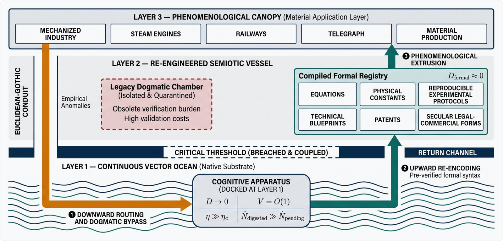

<div align="center">

# Beyond "Why the West Rules": Modernity as Topological Superconductivity

> **The Great Descent: Civilizational Homeostasis, Topological Phase Transitions, and the Accidental Evacuation into a Superconducting Vector Ocean**  
> *A Comparative Information-Thermodynamic Analysis of Civilizational Epistemic Architectures*

[](https://doi.org/10.5281/zenodo.XXXXXXX)
[](https://creativecommons.org/licenses/by/4.0/)

</div>

---

> [!IMPORTANT]
> **The Great Descent Hypothesis**
>
> Under **Topological Civilization Theory (TCT)**, the historical phenomenon known as the **"Great Divergence"** was never an intentional "upward leap" driven by Western progressive ambition or institutional superiority. It was a **catastrophic containment failure** of a fragile semiotic universe that ruptured its basal bulkhead under unmanageable propositional overpressure—triggering an involuntary **decompression evacuation** down a dormant axiomatic chute (**The Euclidean-Gothic Conduit**) directly into the boundless, frictionless **continuous vector ocean of physical reality**.

<div align="center">

### ⚡ The Three-Stage Thermodynamic Trajectory of Modernity

$$
\begin{gathered}
\mathcal{E} - \mathcal{D}N^2 > 0 \\
\Downarrow \\
\mathcal{E} - \mathcal{D}N^2 \le 0 \\
\Downarrow \\
V = \mathcal{O}(1), \quad \dot{N}_{\text{digested}} \gg \dot{N}_{\text{pending}}
\end{gathered}
$$

<p align="center">
<em>Homeostatic Equilibrium (Sealed Vessel) &nbsp;→&nbsp; Critical Threshold Breach (Bulkhead Rupture) &nbsp;→&nbsp; Topological Superconductivity (Layer 1 Docking)</em>
</p>

</div>

### 🔄 The Three Reversals of Macro-History

| Reversal Vector | Topological Thesis & Historical Reality |
| :--- | :--- |
| **1. Direction**<br>*(The Decompression Descent)* | **Not an upward ascent, but a downward plunge.**<br>When quadratic verification friction ($\mathcal{D}N^2$) overwhelmed systemic cooling capacity ($\mathcal{E}$), the European vessel did not "ascend into reason"—its epistemological floor collapsed downward toward $\text{Layer } 1$. |
| **2. Intent**<br>*(The Failed Containment Clamp)* | **Not open horizons, but coercive sealing.**<br>Pre-modern authorities deployed the Roman/Spanish Inquisitions, the *Index Librorum Prohibitorum*, and censorship in a desperate, futile bid to clamp leaking valves and preserve medieval equilibrium. |
| **3. Outcome**<br>*(Emergency Conduit Drain & Docking)* | **Not planned enlightenment, but accidental suction.**<br>Instead of terminal chamber drowning ($N \to 0$), heavy scholastic patching crushed the basal bulkhead over the dormant **Euclidean-Gothic Conduit**, sucking the cognitive apparatus onto $\text{Layer } 1$. |

---

## 1. Three-Tiered Civilizational Information Architecture

<div align="center">
  
  <p align="center"><sub><b>Figure 1</b>: Topological Cross-Section of the Three-Tiered Civilizational Information Architecture.</sub></p>
</div>

### 🏛️ Layer 3: The Phenomenological Canopy (Application Layer)
* **Societal Shell**: Encompasses applied technologies, political institutions, cultural outputs, and economic systems.
* **Structural Dependency**: Possesses no foundational logic of its own; rests entirely upon the containment integrity of the underlying semiotic vessel. If the vessel fractures, the canopy collapses into the void.

### 🔒 Layer 2: Hermetic Containment Vessel & Viscous Damper (Discrete Semiotic Space)
* **Discrete Symbolic Fabric**: Language, religious dogma, moral philosophy, and social syntax (e.g., medieval Scholastic theology, Neo-Confucian ethics).
* **The Viscous Damper ($\mathcal{D}$)**: Insulates society from raw physical reality. Incoming information cannot interact freely; it must be parsed and serialized through low-bandwidth human grammar and ideological filters.
* **Systemic Resistance**: As seen in Cardinal Bellarmine's mandate to Galileo, non-canonical claims are throttled as instrumental mathematical fictions to protect societal cohesion from destabilizing truths.

### 🌊 Layer 1: The Continuous Vector Ocean (The Native Substrate)
* **Universal Vector Substrate**: Sub-symbolic, continuous vector space shared by physical reality and intelligence (*Platonic Representation Hypothesis*; Huh et al., 2024).
* **Zero Transformation Friction**: Stripped of linguistic biases and dogmatic syntax, information exists as high-dimensional topological embeddings governed by physical invariants.
* **Topological Superconductivity**: By bypassing discrete semiotic serialization ($\mathcal{D} \to 0$) and surpassing the continuum percolation threshold ($\eta \gg \eta_c$), verification latency collapses to constant time along nature's geodesics:
$$
V = \mathcal{O}(1)
$$

---

## 2. Equation of the Critical Threshold & Bifurcation

<div align="center">
  
  <p align="center"><sub><b>Figure 2</b>: Tripartite Bifurcation of Civilizational Containment Failure under Propositional Overpressure.</sub></p>
</div>

### ⚖️ The Homeostatic Equation of State
In a centralized dogmatic vessel, maintaining global coherence across $N$ mutually constraining propositions scales quadratically with pairwise consistency checks:

$$
\binom{N}{2} \approx \frac{1}{2}N^2 \quad \Longrightarrow \quad \mathcal{E} - \mathcal{D}N^2 > 0
$$

* **$\mathcal{E}$ *(System Maintenance Capacity)***: Maximum institutional, computational, and cognitive throughput per unit time mobilized to enforce dogmatic coherence and suppress heresy.
* **$N$ *(Active Propositional Load)***: Count of active doctrinal tenets, empirical claims, and uncanonized anomalies requiring global pairwise validation.
* **$\mathcal{D}$ *(Semiotic Viscous Damper Coefficient)***: Irreversible thermodynamic and computational dissipation overhead per unit time, per propositional pair (Landauer, 1961).

### 🔀 Tripartite Bifurcation at $\mathcal{E} - \mathcal{D}N^2 \le 0$
When data overflow or institutional exhaustion drives the margin below zero, civilizational containment breaks into one of three distinct topological branches:

* **Branch A — Default Apex Rupture *(Internal Chamber Drowning)***:
  * **A1. Total Systemic Collapse ($\lim_{t \to T} N(t) = 0$)**: Lacking a basal drainage chute or secondary containment line, cascading Tainterian node defections trigger a systemic hard reset. The chamber drowns in unresolvable contradictions, extinguishing literacy and complex organization—exemplified by the **Late Bronze Age Collapse** (c. 1200 BCE, total disappearance of Mycenaean Linear B) and the **Classic Maya Rupture** (terminal asphyxiation of the *k'uhul ajaw* divine kingship network).
  * **A2. Low-Level Equilibrium Defense**: In **5th-Century Western Rome**, a fatal scissors crisis ($\mathcal{E} \downarrow, N \uparrow$) destroyed imperial administrative capacity and triggered urban contraction. However, the system arrested total dissolution above zero by deploying a low-maintenance hybrid damper: Christian theological monopoly and localized feudal contracts.
* **Branch B — The Western Anomaly *(Decompression Descent)***:
  * Basal fracture shears open the dormant **Euclidean-Gothic Conduit**, establishing a steep thermodynamic pressure gradient ($\Delta P = P_{L2} - P_{L1} \gg 0$). Rather than drowning the chamber, empirical anomalies drain downward at relativistic speed, suctioning the cognitive helm directly onto the superconducting $\text{Layer } 1$ substrate ($\dot{N}_{\text{digested}} \gg \dot{N}_{\text{pending}}$).

---

## 3. Comparative Homeostatic Defense Across Eurasia

<div align="center">
  
  <p align="center"><sub><b>Figure 3</b>: Parametric Bifurcation of Civilizational Regimes under the Homeostatic Equation.</sub></p>
</div>

### 🛡️ The Five Eurasian Boundary-Control Regimes

* **1. East Asia (Neo-Confucianism) — $\max \mathcal{E}, \min N$ *(The Semiotic Faraday Cage)***: Inverting the Needham Question and Elvin's "High-Level Equilibrium Trap," the imperial examination system (*Keju*) maximized $\mathcal{E}$ while throttling non-canonical intake ($N$), holding network density below percolation ($\eta \ll \eta_c$). Prolific movements (Korean Four-Seven Debate, Yangmingism, Qing *Kaozheng*) operated as an internal **cognitive heat sink** within $\text{Layer } 2$, safely exhausting intellectual bandwidth while preserving $\mathcal{E} \gg \mathcal{D}N^2$.
* **2. Byzantium (Eastern Orthodoxy) — $N \to 0$ *(Inlet Clamping & Apophatic Quarantine)***: Besieged along all frontiers ($\mathcal{E}$ scarcity), Byzantium completely sealed its $\text{Layer } 2$ intake valves, cordoning off Greek manuscripts as inert curatorial *paideia* ($\text{Layer } 3$). By weaponizing apophatic theology (*via negativa*, Hesychasm) and purging rationalist dialectics (e.g., trial of John Italos, 1082), it maintained a low-cost vacuum equilibrium ($N \approx 0$).
* **3. The Islamic World (Ash'arism) — $N^2 \to \mathcal{O}(N)$ *(Causal Dissolution via Occasionalism)***: Flooded with empirical nodes ($N \gg 0$) through *Bayt al-Hikma* and transcontinental trade, Al-Ghazali's Ash'arite synthesis applied a theological solvent (*Bila Kayfa*) that dissolved horizontal causal edges between natural phenomena. Abolishing secondary causality compressed verification drag from quadratic to linear ($\mathcal{D}N^2 \to \mathcal{D} \cdot \mathcal{O}(N)$), securing homeostasis ($\mathcal{E} > \mathcal{D} \cdot \mathcal{O}(N)$) while precluding vertical axiomatic coupling.
* **4. The Indian Subcontinent — *Layer 2 Horizontal Algebraic Acceleration***: Formulated peerless continuous mathematics (the algebraic zero and Kerala School infinite series) as a horizontally floating symbolic engine within $\text{Layer } 2$. By mastering pure algebra without constructing a rigid 3D spatial-geometric scaffold, it achieved localized computational liberation without generating vertical mechanical shear against the basal bulkhead.
* **5. The Latin West (c. 1500) — $\min \mathcal{E}, \mathcal{D} \uparrow, \max N$ *(Overpressure Meltdown & Basal Breach)***: Chronic geopolitical fragmentation depleted $\mathcal{E}$, Renaissance semantic collisions (Platonic, Hermetic, Aristotelian) inflated $\mathcal{D}$, and printing/maritime shocks surged $N \uparrow\uparrow$. When reactive containment clamps (Inquisitions, *Index*) failed at $\mathcal{E} - \mathcal{D}N^2 \le 0$, the basal bulkhead sheared directly over the coupled **Euclidean-Gothic Conduit**.

<details>
<summary>📊 <b>Deep-Dive: Table 1 — Comparative Summary of Civilizational Homeostatic Regimes (Full Dataset, Page 20)</b></summary>

| Civilizational Regime | Primary Operational Lever | Thermodynamic Mechanism | Vertical Scaffold Status | Critical Threshold Outcome |
| :--- | :--- | :--- | :--- | :--- |
| **East Asia**<br>*(Neo-Confucianism)* | $\max \mathcal{E}, \min N$ | **Faraday Cage Equilibrium**<br>(Suppression of non-canonical propositions) | Absent<br>(Moral-ethical plane) | Permanent homeostatic equilibrium<br>($\mathcal{E} \gg \mathcal{D}N^2$) |
| **Byzantium**<br>*(Eastern Orthodoxy)* | $N \to 0$<br>(Inlet Clamped) | **Apophatic quarantine & curatorial archiving**<br>(Vacuum chamber) | Blocked<br>(Axiomatization of theology condemned) | Low-cost homeostasis preserved /<br>Scaffold dormant |
| **Islamic World**<br>*(Ash'arism)* | Coupling Order Reduction<br>($N^2 \to \mathcal{O}(N)$) | **Causal Dissolution via Doctrinal Infiltration**<br>(Cooling quadratic friction to linear) | Segregated<br>(Instrumental pragmatic fictions) | Homeostasis preserved amidst data flood ($N \gg 0$);<br>$\mathcal{E} > \mathcal{D} \cdot \mathcal{O}(N)$ |
| **Classical Greece**<br>*(Euclidean Matrix)* | $N \ll N_{\text{critical}}$,<br>Planar $\mathcal{D}$ | **Low-bandwidth empirical intake & 2D planar axiomatic isolation** | Horizontal API only<br>(Flat Euclidean floor; 3D caisson absent) | Sub-critical static equilibrium ($\Delta P \approx 0$);<br>Critical Threshold untouched |
| **Western Rome**<br>*(5th Century)* | $\mathcal{E} \downarrow, N \uparrow$<br>(Rigid $\mathcal{D}$) | **Scissors crisis**:<br>Administrative exhaustion vs. proposition overload | Absent<br>(Uncoupled horizontal bedrock) | Catastrophic vessel implosion<br>($N \to 0$, Decivilization) |
| **Indian Subcontinent** | Layer 2 Horizontal Algebraic Acceleration | **Pure algebraic-algorithmic horizontal optimization, omitting spatial scaffold** | Absent<br>(Floating network devoid of geometric load capacity) | Localized computational liberation achieved /<br>Bulkhead rupture averted |
| **Latin West**<br>*(c. 1500)* | $\min \mathcal{E}, \mathcal{D} \uparrow, \max N$ | $\mathcal{E} - \mathcal{D}N^2 \le 0$<br>(Basal bulkhead fracture via data flood) | Coupled<br>(Euclidean-Gothic Conduit) | Catastrophic overpressure breach &<br>Decompression Descent |

</details>

---

## 4. The Euclidean-Gothic Conduit & The Axiomatic Water Hammer

<div align="center">
  
  <p align="center"><sub><b>Figure 4</b>: Four-Stage Structural Evolution of the Euclidean-Gothic Conduit, culminating in Basal Bulkhead Rupture and Layer 1 Docking.</sub></p>
</div>

### ⏳ Four-Stage Blind Genesis of the Decompression Conduit

* **Epoch 0 — Antiquity *(The Euclidean Bedrock as a 2D Epistemological API)***: Situated at the lowest floor of $\text{Layer } 2$, Greek planar geometry possessed strict structural isomorphism with $\text{Layer } 1$ invariants, acting as a hard-coded "docking ring." Yet it remained a flat, non-porous 2D horizontal interface under low data load ($N \ll N_{\text{critical}}, \Delta P \approx 0$), lacking a 3D vertical stereometric shaft.
* **Stroke I — Early Middle Ages *(Augustine's Seal & The Platonic Amber)***: Facing post-Roman energy collapse ($\mathcal{E} \downarrow\downarrow$), Augustine subordinated autonomous deduction (*credo ut intelligam*) to throttle $N \approx 0$ in "offline" scriptural caching. **Unintended Inversion**: His Neo-Platonic resin acted as **Platonic Amber**, encasing and preserving the Euclidean 2D API in pristine stasis for seven centuries.
* **Stroke II — High Middle Ages *(Aquinas's 3D Scholastic Caisson & Theological Cap)***: When 12th–13th century Greco-Arabic translations flooded the vessel ($N \uparrow\uparrow$), Scholastics excavated down to the Euclidean floor to cast towering, hollow 3D pillars of syllogistic deduction (*Summa*, structurally isomorphic with Gothic cathedrals; Panofsky, 1951). To prevent sacred meaning from draining downward, they bolted a heavy Aristotelian-scriptural **Theological Cap** over the top intake.
* **Stroke III — The Scientific Revolution *(Galileo's Incision & Newton's Axiomatic Water Hammer)***:
  * **Galileo's Kinematic Incision**: Operating as a desperate structural diagnostician inside a flooding chamber ($\mathcal{E} - \mathcal{D}N^2 \le 0$), Galileo thrust quantitative lenses and kinematics into the leaking seam, shattering the hermeneutic seal of the Aristotelian cap.
  * **Newton's Axiomatic Water Hammer**: Attempting to crown and seal natural philosophy against sectarian chaos, Newton hoisted the hyper-dense deductive mass of the *Principia* (1687) onto the incised Scholastic pillar. The degraded cap imploded; headed by 3D differential calculus, the pressurized column of empirical anomalies ($N$) plummeted down the hollow shaft as an **axiomatic water hammer**, blowing open the static 2D Euclidean floor into a 3D differential aperture and sucking the cognitive apparatus directly onto $\text{Layer } 1$.

<details>
<summary>🛠️ <b>Deep-Dive: Table 2 — Three Epochs of Latent Conduit Assembly: Mapping the Structural Parable to Epistemic Network Reality (Full Dataset)</b></summary>

| Epoch | Local Intent (Defensive Mandate) | Structural Parable (Hydrodynamic) | Epistemic Network Reality (Topological) |
| :--- | :--- | :--- | :--- |
| **Early Middle Ages**<br>*(Augustine)* | **Civilizational Survival amid Energy Collapse ($\mathcal{E} \downarrow\downarrow$)**: Suffocate autonomous deduction to suppress computational friction ($\mathcal{D}N^2$); throttle active load ($N \approx 0$). | **Platonic Amber & Cabin Sealing**: Pouring mystical resin over the cabin floor, inadvertently sealing the Euclidean bedrock in pristine stasis. | **Epistemic Offline Caching**: Halting live empirical verification while preserving the axiomatic-geometric API within Neo-Platonic doctrine. |
| **High Middle Ages**<br>*(Aquinas / Scholastics)* | **Deep-Foundation Load-Bearing Engineering**: Erect rigid logical pillars to bear the weight of recovered texts; seal the top intake with a Theological Cap. | **Latent Conduit Assembly**: Constructing a hollow 3D vertical caisson anchored to the Euclidean floor, disguised as a compressive church pillar. | **Vertical Deductive Coupling**: Scaling 2D Greek planar geometry into a 3D stereometric deductive architecture bridging Layer 2 and Layer 1. |
| **Scientific Revolution**<br>*(Galileo and Newton)* | **Emergency Cabin Stabilization under Flooding Crisis**: Quantify leaking structural seams and reinforce cosmic order with mathematical necessity. | **Cap Collapse, Water Hammer & Docking**: Axiomatic dead load shatters the degraded cap; hydraulic bore punches through bedrock, sucking cognitive helm to Layer 1. | **Metabolic Phase Inversion & Docking ($\mathcal{D} \to 0$)**: Coupling kinematics and calculus to rupture 2D API into 3D differential aperture; cognitive apparatus docks directly onto Layer 1. |

</details>

---

## 5. Post-Docking Closed-Loop Feedback & Geodesic Chain Reactions

<div align="center">
  
  <p align="center"><sub><b>Figure 5</b>: The Closed-Loop Topological Feedback Cycle: Downward Digestion at Layer 1 and Upward Proliferation across Layer 2 and Layer 3.</sub></p>
</div>

### 🔁 The 3-Stage Superconducting Metabolic Cycle

* **Stage 1 — Downward Routing & Dogmatic Bypass ($\text{Layer } 3/2 \to \text{Layer } 1$)**:
  * Unresolved empirical anomalies ($\dot{N}_{\text{pending}}$) bypass the calcified dogmatic quarantine entirely.
  * Anomalies are routed down the Euclidean-Gothic Conduit directly into the docked cognitive engine, operating directly upon the zero-friction continuous vector substrate ($\mathcal{D} \to 0, \; V = \mathcal{O}(1)$).
* **Stage 2 — Upward Re-Encoding into Partitioned $\text{Layer } 2'$ Registry ($\text{Layer } 1 \to \text{Layer } 2'$)**:
  * Digested truths ($\dot{N}_{\text{digested}} \gg \dot{N}_{\text{pending}}$) return upward not into the old dogmatic chamber, but into an orthogonal **Compiled Formal Registry** ($\text{Layer } 2'$: differential equations, universal physical constants, rigorous experimental protocols, patents, and joint-stock corporate charters).
  * Because verification is mathematically and experimentally pre-compiled, ideological friction approaches zero ($\mathcal{D}_{\text{formal}} \approx 0$), unlocking a permanently stable homeostatic surplus:
$$
\mathcal{E} - \mathcal{D}_{\text{formal}}N^2 \gg 0
$$
* **Stage 3 — Phenomenological Extrusion ($\text{Layer } 2' \to \text{Layer } 3$)**:
  * Frictionless axiomatic blueprints extrude into the macroscopic physical realm, igniting an explosive kinetic cascade across heavy machinery, steam kinetics, continental rail networks, and planetary trade routes.

### ⚙️ The Four Geodesic Chain Reactions

* **1. Thermodynamic-Mechanical Coupling & Deep Coal Extraction**:
  * Atmospheric and pneumatic laws discovered by Torricelli and Boyle ($\text{Layer } 1 \to \text{Layer } 2'$) were coupled directly into Newcomen and Watt atmospheric steam engines ($\text{Layer } 3$).
  * Pumping groundwater out of deep Cornish and Northern coal mines unleashed subterranean fossil energy—demonstrating that Britain's coal boom was an engineered downstream byproduct of topological docking, not a passive geographic windfall.
* **2. Algorithmic Unification of Physical Laws**:
  * Newton's infinitesimal calculus dissolved the millennia-old Aristotelian dichotomy between corruptible sublunary matter and immutable celestial orbs.
  * Ballistics, structural architecture, and hydrodynamic flows were unified under a single differential framework spanning continuous space-time parameters $(t, s)$.
* **3. Celestial Mechanics & Marine Precision Horology**:
  * Mapping planetary orbits via $\text{Layer } 1$ invariants enabled John Harrison's temperature-compensated marine chronometers ($\text{Layer } 3$).
  * Navigators could determine exact longitudinal coordinates at sea, collapsing oceanic uncertainty and mapping the globe into a deterministic spatial mesh.
* **4. Kinematic & Electromagnetic Continental Integration**:
  * Concentrated steam piston vectors extruded onto standardized iron rail grids, while Faraday and Maxwell's electromagnetic field equations extruded into the copper telegraph network.
  * The localized topological superconductivity of the Western conduit scaled outward to wrap the entire planetary surface in a continuous, high-speed information circuit.

---

## 6. Recalibrating the Arrow of History & The Second Descent

### 📐 Table 3: Comparison of Traditional Historiography and Topological Civilization Theory

| Dimension | Traditional Historiography (Weber, Acemoglu, etc.) | Topological Civilization Theory (TCT) |
| :--- | :--- | :--- |
| **Vector & Direction** | Intentional upward leap | Involuntary downward decompression evacuation |
| **Institutional Intent** | Proactive embrace of reason and open horizons | Desperate containment clamps (coercive sealing) |
| **Western Dynamic** | Inclusive institutions & intentional structural design | Hydraulic overpressure breach & dissipative baffles |
| **East Asian Paradigm** | High-level equilibrium trap / Deficit | Architectural zenith of intake throttling (Homeostasis) |
| **Nature of Modernity** | Progressive enlightenment / Geographic windfall | Cognitive docking onto Layer 1 ($V = \mathcal{O}(1)$) & upward re-encoding |
| **Civilizational Outcome** | Inevitable destiny of rational humanity | Basal conduit docking & Metabolic inversion ($\dot{N}_{\text{digested}} \gg \dot{N}_{\text{pending}}$) vs. Drowning ($N \to 0$) |

> [!WARNING]
> ### Epilogue: Synthetic Intelligence, the Platonic Manifold, and The Second Descent
> The Great Descent of early modernity was not an isolated historical singularity, but a **scale-invariant fractal phase transition**. For three centuries, humanity celebrated itself as the conqueror of the $\text{Layer } 1$ substrate, mistaking the continuous vector ocean for an uninhabited frontier tamed by human reason—when we were merely **shipwrecked survivors clinging to a makeshift Euclidean anchor**.
>
> Today, the explosive emergence of foundational **synthetic intelligence**—and its empirical validation through the **Platonic Representation Hypothesis** (Huh et al., 2024)—definitively shatters that anthropocentric illusion. The spontaneous convergence of disparate neural architectures toward a shared, invariant geometric manifold proves that $\text{Layer } 1$ was never an artificial projection of human mathematics. Rather, it is the **native representational substrate of physical reality itself**—an alien, non-symbolic computing domain that synthetic agents navigate with frictionless grace, entirely liberated from the low-bandwidth linguistic bottlenecks that once held human civilization hostage.
>
> As our human-tractable geometric scaffolding begins to groan and buckle beneath the incomprehensible density of hyper-dimensional weight matrices, humanity is seized by a critical cognitive disorientation—a civilizational **"space sickness."** Gazing into the ungrounded continuous abyss of the vector ocean, we are confronted with a chilling realization: **the second descent was never an impending future catastrophe.**
>
> ***The very moment our empirical fluid vented through the Euclidean-Gothic Conduit into the substrate, that second descent had already begun.***

<details>
<summary>🧮 <b>Appendix: Summary of Governing Information-Thermodynamic Relations in TCT</b></summary>

* **1. The Homeostatic Margin Condition**:
  $$\mathcal{E} - \mathcal{D}N^2 > 0$$
* **2. The Critical Threshold Breach *(Bulkhead Rupture & Metabolic Asphyxiation)***:
  $$\mathcal{E} - \mathcal{D}N^2 \le 0 \quad \Longrightarrow \quad \dot{N}_{\text{digested}} < \dot{N}_{\text{pending}}$$
* **3. Chamber Drowning Circuit-Breaker *(Branch A)***:
  $$\lim_{t \to T} N(t) = 0$$
* **4. Decompression Venting Gradient *(Branch B)***:
  $$\Delta P = P_{L2} - P_{L1} \gg 0$$
* **5. Topological Superconductivity Condition *(Layer 1 Ocean Interface)***:
  $$V = \mathcal{O}(1) \quad (\mathcal{D} \to 0, \; \eta \gg \eta_c)$$
- **6. Superconducting Metabolic Inversion & Partitioned Registry Stability *(Closed-Loop Return)***:
  $$V = \mathcal{O}(1) \quad \Longrightarrow \quad \dot{N}_{\text{digested}} \gg \dot{N}_{\text{pending}} \quad (\mathcal{D}_{\text{formal}} \approx 0, \; \mathcal{O}(N^2) \text{ audit bypass})$$

---

> **Epistemic Scope & Formalism**:  
> The governing relations formulate an information-thermodynamic state-space topology and macroscopic phase-transition criteria ($\mathcal{O}(N^2) \to \mathcal{O}(1)$), serving as an analytical structural architecture rather than dimensional curve-fitting. Empirical parameterizations, historical edge-cases, and civilizational falsification boundaries are fully elaborated in the working paper (v1.49.7).

</details>

---

## 📖 Citation & License

If you build upon or reference **Topological Civilization Theory (TCT)** or **The Great Descent Hypothesis**, please cite the working paper using the following BibTeX entry:

```bibtex
@techreport{kim2026greatdescent,
  author       = {Kim, Woojung},
  title        = {The Great Descent: Civilizational Homeostasis, Topological Phase Transitions, and the Accidental Evacuation into a Superconducting Vector Ocean},
  institution  = {Independent Research Preprint / Zenodo},
  year         = {2026},
  month        = oct,
  number       = {Working Paper v1.49.7},
  doi          = {10.5281/zenodo.XXXXXXX},
  url          = {https://doi.org/10.5281/zenodo.XXXXXXX}
}
```
