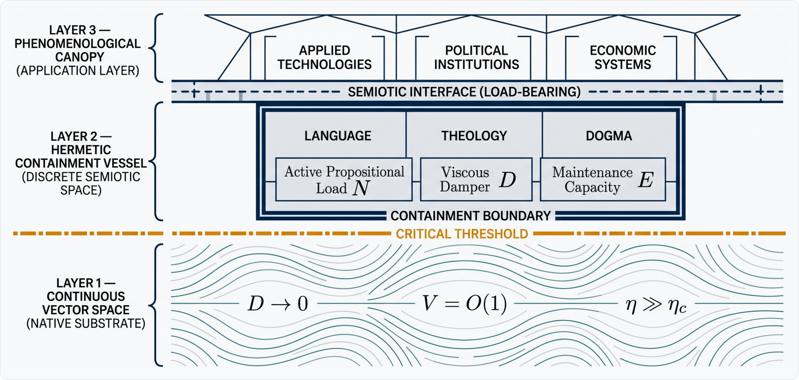
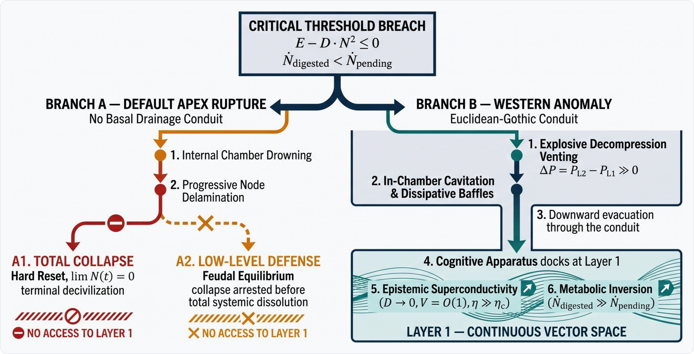
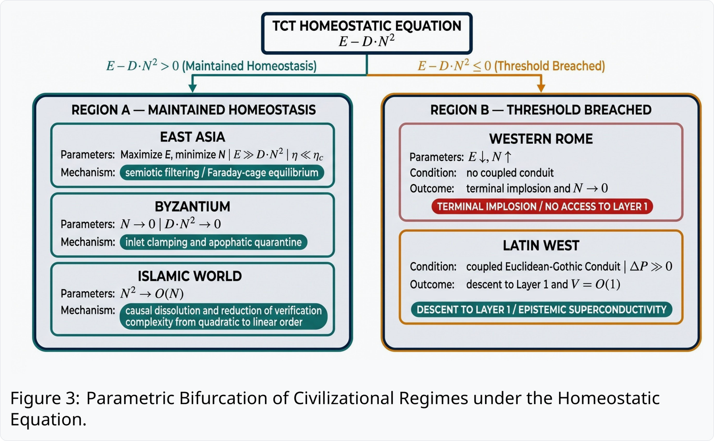
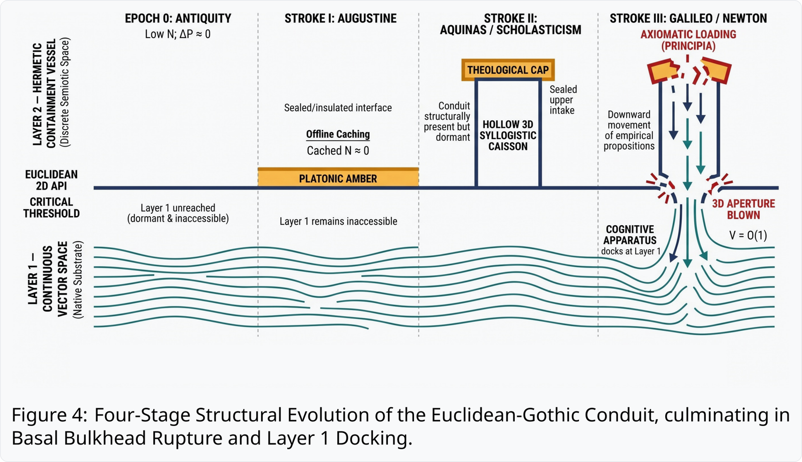

<div style="margin-bottom: 1.5rem;">
  <p style="color: #1e40af; font-size: 0.92rem; font-weight: 700; letter-spacing: 0.04em; text-transform: uppercase; margin-top: 0; margin-bottom: 0.45rem;">
    Beyond “Why the West Rules” · Modernity as Topological Superconductivity
  </p>

  <h1 style="color: #0f172a; font-weight: 800; letter-spacing: -0.02em; line-height: 1.25; margin-top: 0; margin-bottom: 0.65rem; border-bottom: none;">
    The Great Descent:
    <span style="font-weight: 500; color: #334155; font-size: 0.72em; display: block; margin-top: 0.3rem; line-height: 1.45;">
      Civilizational Homeostasis, Topological Phase Transitions, and the Accidental Evacuation into a Superconducting Vector Ocean
    </span>
  </h1>

  <p style="color: #64748b; font-size: 1.02rem; font-style: italic; margin-top: 0; margin-bottom: 1.1rem;">
    A Comparative Information-Thermodynamic Analysis of Civilizational Epistemic Architectures
  </p>

  <p style="margin: 0;">
    <a href="https://doi.org/10.5281/zenodo.23445726" style="text-decoration: none; margin-right: 0.4rem;">
      
    </a>
    <a href="https://creativecommons.org/licenses/by/4.0/" style="text-decoration: none;">
      
    </a>
  </p>
</div>

<blockquote style="margin: 1.8rem 0 2.2rem 0; padding: 1.3rem 1.5rem; background: linear-gradient(to right, #f8fafc, #ffffff); border: 1px solid #e2e8f0; border-left: 4px solid #1e3a8a; border-radius: 6px; color: #334155; font-size: 1.02rem; line-height: 1.75; font-style: normal; box-shadow: 0 1px 2px rgba(15, 23, 42, 0.03);">
  <div style="margin: 0; color: #334155;">
    <strong style="color: #1e3a8a; font-weight: 700; letter-spacing: 0.01em;">Core Premise —</strong> Under <strong style="color: #0f172a; font-weight: 600;">Topological Civilization Theory (TCT)</strong>, a civilization’s essence is <strong style="color: #0f172a; font-weight: 600;">homeostatic defense</strong>, not progress. Therefore, the “Great Divergence” was never an intentional “upward leap” driven by Western progressive ambition or institutional superiority. It was a <strong style="color: #0f172a; font-weight: 600;">catastrophic containment failure</strong> of a fragile semiotic universe that ruptured its basal bulkhead under unmanageable propositional overpressure—forcing human cognition into a <strong style="color: #0f172a; font-weight: 600;">decompression evacuation</strong> down a dormant axiomatic chute (the <strong style="color: #0f172a; font-weight: 600;">Euclidean-Gothic Conduit</strong>) into the frictionless <strong style="color: #0f172a; font-weight: 600;">continuous vector ocean</strong> of physical reality. This unintended rupture-descent and the resulting accidental acquisition of <strong style="color: #0f172a; font-weight: 600;">topological superconductivity</strong> constitute the very core of modernity.
  </div>
</blockquote>

### Three Directional Reversals in Great Divergence Historiography

| Reversal Vector | Topological Inversion & Historiographical Positioning |
| :--- | :--- |
| **1. Direction of the Breakthrough** | **Not an upward leap, but a downward plunge**: Against the stalled-ascent and “equilibrium trap” narratives of **Joseph Needham (1969)**, **Mark Elvin (1973)**, and **Ian Morris (2010)**, East Asia actually succeeded in homeostatic containment while Europe suffered a structural floor collapse. |
| **2. Intent of Ruling Authorities** | **Not inclusive open horizons, but failed coercive sealing**: Against **Max Weber (1905)**, **Douglass North (1973)**, and **Daron Acemoglu (2012)**, European authorities deployed desperate ideological clamps that ruptured under overpressure—reducing “inclusive institutions” and “property rights” to reactive **dissipative baffles** improvised to damp post-breach cavitation turbulence. |
| **3. Engine of Industrial Dominance** | **Not passive geographic windfall, but accidental cognitive docking**: Against the ecological and resource-windfall models of **Jared Diamond (1997)** and **Kenneth Pomeranz (2000)**, industrial dominance was the downstream byproduct of Europe’s cognitive apparatus accidentally plunging into a frictionless continuous vector ocean. |

---

## 1. Three-Tiered Civilizational Information Architecture

<figure style="margin: 2rem 0; padding: 1.25rem 1.25rem 1rem 1.25rem; background-color: #ffffff; border: 1px solid #e2e8f0; border-radius: 8px; box-shadow: 0 1px 3px rgba(15, 23, 42, 0.03); text-align: center;">
  
  <figcaption style="margin-top: 0.9rem; padding-top: 0.75rem; border-top: 1px solid #f1f5f9; color: #475569; font-size: 0.92rem; line-height: 1.5; text-align: center;">
    <strong style="color: #0f172a; font-weight: 700;">Figure 1</strong> &nbsp;|&nbsp; Topological Cross-Section of the Three-Tiered Civilizational Information Architecture.
  </figcaption>
</figure>

- **Layer 3 — The Phenomenological Canopy**: The **derivative application space** of visible institutions and technologies, wholly dependent on the load-bearing semiotic floor below.
- **Layer 2 — Hermetic Containment Vessel**: The **viscous symbolic space** ($\mathcal{D}$) that insulates societal homeostasis by filtering raw physical reality.
- **Layer 1 — The Continuous Vector Ocean**: The **frictionless native substrate** ($\mathcal{D} \to 0$) where sub-symbolic information flows along physical geodesics with constant-time verification.

---

## 2. Equation of the Critical Threshold

### Condition for Civilizational Homeostasis

The dynamical equation for maintaining homeostasis is given by:

<div style="background-color: #f8fafc; border: 1px solid #e2e8f0; border-radius: 8px; padding: 1rem 1.25rem; margin: 1.2rem 0; text-align: center;">

$$
{\LARGE \mathcal{E} - \mathcal{D}N^2 > 0}
$$

</div>

- **$\mathcal{E}$ *(System Maintenance Capacity)***: Maximum institutional throughput enforcing dogmatic coherence.
- **$N$ *(Active Propositional Load)***: Total count of active doctrines and empirical anomalies.
- **$\mathcal{D}$ *(Semiotic Viscous Damper)***: Irreversible thermodynamic dissipation rate per pairwise check (Landauer, 1961).

As empirical anomalies accumulate ($N \uparrow$), the descent toward structural rupture unfolds in three stages:

$$
\begin{aligned}
{\Large \mathcal{E} - \mathcal{D}N^2 > 0} &\quad \text{(Homeostatic Equilibrium)} \\
\Downarrow \qquad\quad & \\
{\Large \mathcal{E} - \mathcal{D}N^2 \le 0} &\quad \text{(Critical Threshold Breach)}
\end{aligned}
$$

<figure style="margin: 2rem 0; padding: 1.25rem 1.25rem 1rem 1.25rem; background-color: #ffffff; border: 1px solid #e2e8f0; border-radius: 8px; box-shadow: 0 1px 3px rgba(15, 23, 42, 0.03); text-align: center;">
  
  <figcaption style="margin-top: 0.9rem; padding-top: 0.75rem; border-top: 1px solid #f1f5f9; color: #475569; font-size: 0.92rem; line-height: 1.5; text-align: center;">
    <strong style="color: #0f172a; font-weight: 700;">Figure 2</strong> &nbsp;|&nbsp; Tripartite Bifurcation of Civilizational Containment Failure under Propositional Overpressure.
  </figcaption>
</figure>

### Tripartite Bifurcation at $\mathcal{E} - \mathcal{D}N^2 \le 0$

When propositional overpressure drives the metabolic margin below zero ($\mathcal{E} - \mathcal{D}N^2 \le 0$), civilizational containment bifurcates into one of three distinct trajectories (Figure 2):

- **Pathway A1 — Total Collapse *(Hard Reset)***: Without a basal conduit or damper, chamber drowning triggers cascading node delamination to $\lim _ {t \to T} N(t) = 0$ (**Late Bronze Age Collapse**, **Classic Maya**).
- **Pathway A2 — Low-Level Defense *(Feudal Equilibrium)***: Terminal dissolution is arrested at a low-maintenance equilibrium via theological monopoly and feudal contracts (**5th-Century Western Rome**).
- **Pathway B — The Western Anomaly *(Decompression Descent)***: Explosive decompression through the **Euclidean-Gothic Conduit** docks the cognitive apparatus onto Layer 1 ($\dot{N}\_{\mathrm{digested}} \gg \dot{N}\_{\mathrm{pending}}$), while improvised **dissipative baffles** (*"inclusive institutions"*) damp lethal cavitation turbulence (**Early Modern Western Europe**).

---

## 3. Comparative Homeostatic Defense Across Eurasia

<figure style="margin: 2rem 0; padding: 1.25rem 1.25rem 1rem 1.25rem; background-color: #ffffff; border: 1px solid #e2e8f0; border-radius: 8px; box-shadow: 0 1px 3px rgba(15, 23, 42, 0.03); text-align: center;">
  
  <figcaption style="margin-top: 0.9rem; padding-top: 0.75rem; border-top: 1px solid #f1f5f9; color: #475569; font-size: 0.92rem; line-height: 1.5; text-align: center;">
    <strong style="color: #0f172a; font-weight: 700;">Figure 3</strong> &nbsp;|&nbsp; Parametric Bifurcation of Civilizational Regimes under the Homeostatic Equation.
  </figcaption>
</figure>

### The Five Eurasian Boundary-Control Regimes

- **1. East Asia (Neo-Confucianism) — $\max \mathcal{E}, \min N$ *(Semiotic Faraday Cage)***: The *Keju* system throttled external intake and routed internal debates into a Layer 2 **cognitive heat sink** ($\mathcal{E} \gg \mathcal{D}N^2$).
- **2. Byzantium (Eastern Orthodoxy) — $N \to 0$ *(Apophatic Quarantine)***: Clamped Layer 2 intake via Hesychast mysticism while archiving Greek science as inert Layer 3 *paideia*.
- **3. Islamic World (Ash'arism) — $N^2 \to \mathcal{O}(N)$ *(Causal Dissolution)***: Al-Ghazali's occasionalism (*Bila Kayfa*) dissolved secondary causality amidst data floods, linearizing verification drag.
- **4. Indian Subcontinent — Layer 2 *(Algebraic Acceleration)***: Built continuous calculus (Kerala series) as a pure algebraic engine without a 3D geometric scaffold, averting basal shear.
- **5. Latin West (c. 1500) — $\min \mathcal{E}, \mathcal{D} \uparrow, \max N$ *(Overpressure Breach)***: Fragmentation and print/maritime shocks breached $\mathcal{E} - \mathcal{D}N^2 \le 0$, shearing the bulkhead over the **Euclidean-Gothic Conduit**.

<details markdown="1">
<summary>📊 <b>Deep-Dive: Table 1 — Comparative Summary of Civilizational Homeostatic Regimes</b></summary>

| Civilizational Regime | Primary Operational Lever | Thermodynamic Mechanism | Vertical Scaffold Status | Critical Threshold Outcome |
| :--- | :--- | :--- | :--- | :--- |
| **East Asia**<br>*(Neo-Confucianism)* | $\max \mathcal{E}, \min N$ | **Faraday Cage Equilibrium**<br>(Suppression of non-canonical propositions) | Absent<br>(Moral-ethical plane) | Permanent homeostatic equilibrium<br>($\mathcal{E} \gg \mathcal{D}N^2$) |
| **Byzantium**<br>*(Eastern Orthodoxy)* | $N \to 0$<br>(Inlet Clamped) | **Apophatic quarantine & curatorial archiving**<br>(Vacuum chamber) | Blocked<br>(Axiomatization of theology condemned) | Low-cost homeostasis preserved /<br>Scaffold dormant |
| **Islamic World**<br>*(Ash'arism)* | Coupling Order Reduction<br>($N^2 \to \mathcal{O}(N)$) | **Causal Dissolution via Doctrinal Infiltration**<br>(Cooling quadratic friction to linear) | Segregated<br>(Instrumental pragmatic fictions) | Homeostasis preserved amidst data flood ($N \gg 0$);<br>$\mathcal{E} > \mathcal{D} \cdot \mathcal{O}(N)$ |
| **Classical Greece**<br>*(Euclidean Matrix)* | $N \ll N_{\text{critical}}$,<br>Planar $\mathcal{D}$ | **Low-bandwidth empirical intake & 2D planar axiomatic isolation** | Horizontal API only<br>(Flat Euclidean floor; 3D caisson absent) | Sub-critical static equilibrium ($\Delta P \approx 0$);<br>Critical Threshold untouched |
| **Western Rome**<br>*(5th Century)* | $\mathcal{E} \downarrow, N \uparrow$<br>(Rigid $\mathcal{D}$) | **Scissors crisis**:<br>Administrative exhaustion vs. proposition overload | Absent<br>(Uncoupled horizontal bedrock) | Catastrophic vessel implosion<br>($N \to 0$, Decivilization) |
| **Indian Subcontinent** | Layer 2 Horizontal Algebraic Acceleration | **Pure algebraic-algorithmic horizontal optimization, omitting spatial scaffold** | Absent<br>(Floating network devoid of geometric load capacity) | Localized computational liberation achieved /<br>Bulkhead rupture averted |
| **Latin West**<br>*(c. 1500)* | $\min \mathcal{E}, \mathcal{D} \uparrow, \max N$ | $\mathcal{E} - \mathcal{D}N^2 \le 0$<br>(Basal bulkhead fracture via data flood) | Coupled<br>(Euclidean-Gothic Conduit) | Catastrophic overpressure breach &<br>Decompression Descent |

</details>

---

## 4. The Euclidean-Gothic Conduit & The Axiomatic Water Hammer

<figure style="margin: 2rem 0; padding: 1.25rem 1.25rem 1rem 1.25rem; background-color: #ffffff; border: 1px solid #e2e8f0; border-radius: 8px; box-shadow: 0 1px 3px rgba(15, 23, 42, 0.03); text-align: center;">
  
  <figcaption style="margin-top: 0.9rem; padding-top: 0.75rem; border-top: 1px solid #f1f5f9; color: #475569; font-size: 0.92rem; line-height: 1.5; text-align: center;">
    <strong style="color: #0f172a; font-weight: 700;">Figure 4</strong> &nbsp;|&nbsp; Three-Stroke Blind Assembly of the Euclidean-Gothic Conduit, culminating in Basal Bulkhead Rupture and Layer 1 Docking.
  </figcaption>
</figure>

Rather than a teleological march toward empiricism, the Western transition was a **three-stroke blind genesis** in which defensive efforts to preserve theological homeostasis inadvertently erected and ruptured a vertical decompression shaft:

1. **Offline Caching *(Augustine)***: Sealing the 2D Euclidean API in *Platonic Amber* to survive energy collapse ($\mathcal{E} \downarrow\downarrow, N \approx 0$).
2. **Latent Caisson Assembly *(Aquinas)***: Erecting hollow 3D *Scholastic pillars* anchored to the Euclidean floor beneath a *Theological Cap* ($N \uparrow\uparrow$).
3. **Axiomatic Water Hammer *(Galileo & Newton)***: Coupling kinematics and *Principia* calculus to shatter the degraded cap and dock the cognitive apparatus directly onto Layer 1 ($\mathcal{D} \to 0$).

<details markdown="1">
<summary>🛠️ <b>Deep-Dive: Table 2 — Three Epochs of Latent Conduit Assembly: Mapping the Structural Parable to Epistemic Network Reality</b></summary>

| Epoch | Local Intent (Defensive Mandate) | Structural Parable (Hydrodynamic) | Epistemic Network Reality (Topological) |
| :--- | :--- | :--- | :--- |
| **Early Middle Ages**<br>*(Augustine)* | **Civilizational Survival amid Energy Collapse ($\mathcal{E} \downarrow\downarrow$)**: Suffocate autonomous deduction to suppress computational friction ($\mathcal{D}N^2$); throttle active load ($N \approx 0$). | **Platonic Amber & Cabin Sealing**: Pouring mystical resin over the cabin floor, inadvertently sealing the Euclidean bedrock in pristine stasis. | **Epistemic Offline Caching**: Halting live empirical verification while preserving the axiomatic-geometric API within Neo-Platonic doctrine. |
| **High Middle Ages**<br>*(Aquinas / Scholastics)* | **Deep-Foundation Load-Bearing Engineering**: Erect rigid logical pillars to bear the weight of recovered texts; seal the top intake with a Theological Cap. | **Latent Conduit Assembly**: Constructing a hollow 3D vertical caisson anchored to the Euclidean floor, disguised as a compressive church pillar. | **Vertical Deductive Coupling**: Scaling 2D Greek planar geometry into a 3D stereometric deductive architecture bridging Layer 2 and Layer 1. |
| **Scientific Revolution**<br>*(Galileo and Newton)* | **Emergency Cabin Stabilization under Flooding Crisis**: Quantify leaking structural seams and reinforce cosmic order with mathematical necessity. | **Cap Collapse, Water Hammer & Docking**: Axiomatic dead load shatters the degraded cap; hydraulic bore punches through bedrock, sucking cognitive helm to Layer 1. | **Metabolic Phase Inversion & Docking ($\mathcal{D} \to 0$)**: Coupling kinematics and calculus to rupture 2D API into 3D differential aperture; cognitive apparatus docks directly onto Layer 1. |

</details>

---

## 5. Post-Docking Metabolic Inversion & Geodesic Chain Reactions

<figure style="margin: 2rem 0; padding: 1.25rem 1.25rem 1rem 1.25rem; background-color: #ffffff; border: 1px solid #e2e8f0; border-radius: 8px; box-shadow: 0 1px 3px rgba(15, 23, 42, 0.03); text-align: center;">
  
  <figcaption style="margin-top: 0.9rem; padding-top: 0.75rem; border-top: 1px solid #f1f5f9; color: #475569; font-size: 0.92rem; line-height: 1.5; text-align: center;">
    <strong style="color: #0f172a; font-weight: 700;">Figure 5</strong> &nbsp;|&nbsp; The Closed-Loop Topological Feedback Cycle: Downward Digestion at Layer 1 and Upward Proliferation across Layer 2 and Layer 3.
  </figcaption>
</figure>

Docking onto Layer 1 ($\mathcal{D} \to 0$) collapsed verification latency from $\mathcal{O}(N^2)$ to constant-time geometric coupling ($\mathbf{V} = \mathcal{O}(1)$), inverting the metabolic inequality ($\dot{N} _ {\mathrm{digested}} \gg \dot{N} _ {\mathrm{pending}}$) across a **three-stage superconducting loop**:

- **(1) Downward Routing (Layer 3/2 $\to$ Layer 1)**: Bypasses the quarantined *Legacy Dogmatic Chamber* to digest anomalies as pure quantitative vectors.
- **(2) Upward Re-Encoding (Layer 1 $\to$ Layer 2')**: Projects pre-verified vectors into a *Compiled Formal Registry* (equations, blueprints, patents) at zero ideological drag ($\mathcal{D} _ {\mathrm{formal}} \approx 0$).
- **(3) Phenomenological Extrusion (Layer 2' $\to$ Layer 3)**: Extrudes compiled formalisms into a planetary mesh via **four geodesic chain reactions**: **steam-piston coal drainage** *(vacuum/gas laws)*, **unified differentiable mechanics** *(calculus)*, **global coordinate locking** *(marine chronometers)*, and **kinematic rail-telegraph networks**.

---

## Epilogue: Synthetic Intelligence, the Platonic Manifold, and The Second Descent

The Great Descent was not an isolated historical singularity, but a **scale-invariant fractal phase transition**. For three centuries, humanity mistook the Layer 1 vector ocean for a frontier tamed by reason—when we were merely **shipwrecked survivors clinging to a makeshift Euclidean anchor**. Today, **synthetic intelligence** and the **Platonic Representation Hypothesis** (Huh et al., 2024) shatter that anthropocentric illusion: the convergence of disparate neural architectures onto a shared manifold proves that Layer 1 is not a projection of human mathematics, but the **native substrate of physical reality**—navigated by synthetic agents free of Layer 2 linguistic bottlenecks.

As our geometric scaffolding buckles beneath hyper-dimensional weight matrices, a civilizational **“space sickness”** sets in, forcing a chilling realization—**the second descent was never a future catastrophe:**

> ***The very moment our empirical fluid vented through the Euclidean-Gothic Conduit into the substrate, that second descent had already begun.***

<details markdown="1">
<summary>⚖️ <b>Summary Table: Traditional Historiography vs. Topological Civilization Theory (Table 3)</b></summary>

| Dimension | Traditional Historiography (Weber, Acemoglu, etc.) | Topological Civilization Theory (TCT) |
| :--- | :--- | :--- |
| **Vector & Direction** | Intentional upward leap | Involuntary downward decompression evacuation |
| **Institutional Intent** | Proactive embrace of reason and open horizons | Desperate containment clamps (coercive sealing) |
| **Western Dynamic** | Inclusive institutions & intentional structural design | Hydraulic overpressure breach & dissipative baffles |
| **East Asian Paradigm** | High-level equilibrium trap / Deficit | Homeostatic intake throttling |
| **Nature of Modernity** | Progressive enlightenment / Geographic windfall | Cognitive docking onto Layer 1 ($\mathbf{V} = \mathcal{O}(1)$) & upward re-encoding |
| **Civilizational Outcome** | Inevitable destiny of rational humanity | Basal conduit docking ($\dot{N}\_{\mathrm{digested}} \gg \dot{N}\_{\mathrm{pending}}$) vs. Drowning ($N \to 0$) |

</details>

<details markdown="1">
<summary>🧮 <b>Appendix: Summary of Governing Information-Thermodynamic Relations in TCT</b></summary>

- **1. The Homeostatic Margin Condition**:
  $$\mathcal{E} - \mathcal{D}N^2 > 0$$
- **2. The Critical Threshold Breach *(Bulkhead Rupture & Metabolic Asphyxiation)***:
  $$\mathcal{E} - \mathcal{D}N^2 \le 0 \quad \Longrightarrow \quad \dot{N}_{\mathrm{digested}} < \dot{N}_{\mathrm{pending}}$$
- **3. Chamber Drowning Circuit-Breaker *(Branch A)***:
  $$\lim_{t \to T} N(t) = 0$$
- **4. Decompression Venting Gradient *(Branch B)***:
  $$\Delta P = P _ {L2} - P _ {L1} \gg 0$$
- **5. Topological Superconductivity Condition *(Layer 1 Ocean Interface)***:
  $$\mathbf{V} = \mathcal{O}(1) \quad (\mathcal{D} \to 0, \; \eta \gg \eta_c)$$
- **6. Superconducting Metabolic Inversion & Partitioned Registry Stability *(Closed-Loop Return)***:
  $$\mathbf{V} = \mathcal{O}(1) \quad \Longrightarrow \quad \dot{N}_{\mathrm{digested}} \gg \dot{N}_{\mathrm{pending}} \quad (\mathcal{D}_{\mathrm{formal}} \approx 0, \; \mathcal{O}(N^2)\ \mathrm{audit\ bypass})$$

---

> **Epistemic Scope & Formalism**:<br>
> The governing relations formulate an information-thermodynamic state-space topology and macroscopic phase-transition criteria $(\mathcal{O}(N^2) \to \mathcal{O}(1))$, serving as an analytical structural architecture rather than dimensional curve-fitting. Empirical parameterizations, historical edge-cases, and civilizational falsification boundaries are fully elaborated in the working paper (v1.49.7).

</details>

---

## 📖 Citation & License

If you build upon or reference **Topological Civilization Theory (TCT)** or **The Great Descent Hypothesis**, please cite the working paper using the following BibTeX entry:

```bibtex
@techreport{kim2026greatdescent,
  author       = {Kim, Woojung},
  title        = {The Great Descent: Civilizational Homeostasis, Topological Phase Transitions, and the Accidental Evacuation into a Superconducting Vector Ocean},
  institution  = {Independent Research Preprint / Zenodo},
  year         = {2026},
  month        = oct,
  number       = {Working Paper v1.49.7},
  doi          = {10.5281/zenodo.23445726},
  url          = {https://doi.org/10.5281/zenodo.23445726}
}
```

<!-- KaTeX Auto-Render + Anti-FOUC (Drop-in Replacement for README.md) -->
<link rel="stylesheet" href="https://cdn.jsdelivr.net/npm/katex@0.16.11/dist/katex.min.css">
<style>
  /* 수식 변환 완료 전까지 날것의 LaTeX 텍스트 깜빡임 숨김 */
  body:not(.math-ready) { opacity: 0; }
  body.math-ready { opacity: 1; transition: opacity 0.12s ease-in; }
</style>
<script defer src="https://cdn.jsdelivr.net/npm/katex@0.16.11/dist/katex.min.js"></script>
<script defer src="https://cdn.jsdelivr.net/npm/katex@0.16.11/dist/contrib/auto-render.min.js"
  onload="renderMathInElement(document.body, {
    delimiters: [
      {left: '$$', right: '$$', display: true},
      {left: '$', right: '$', display: false},
      {left: '\\(', right: '\\)', display: false},
      {left: '\\[', right: '\\]', display: true}
    ],
    throwOnError: false
  }); document.body.classList.add('math-ready');"></script>
<script>
  // 네트워크 장애 대비 1.2초 안전 타임아웃
  setTimeout(function() { document.body.classList.add('math-ready'); }, 1200);
</script>
